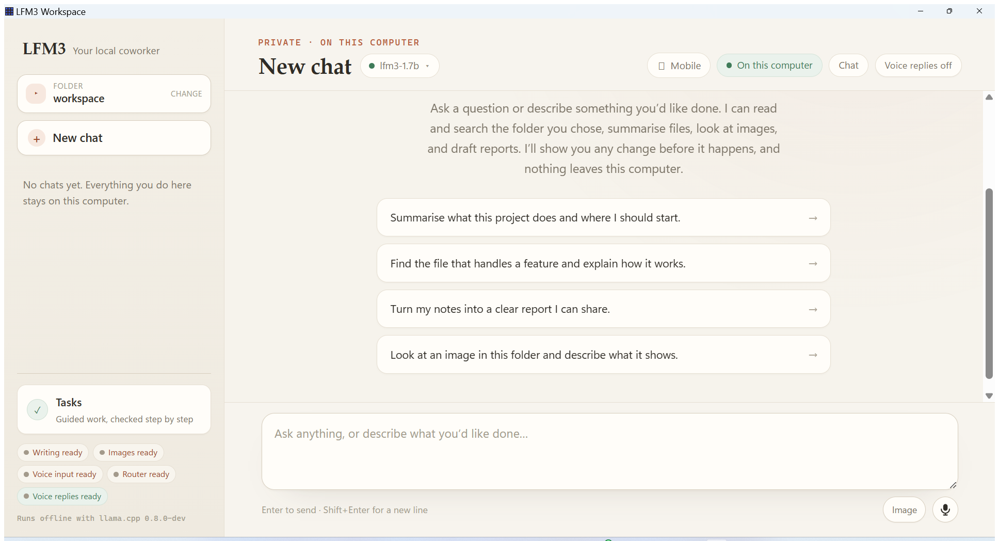
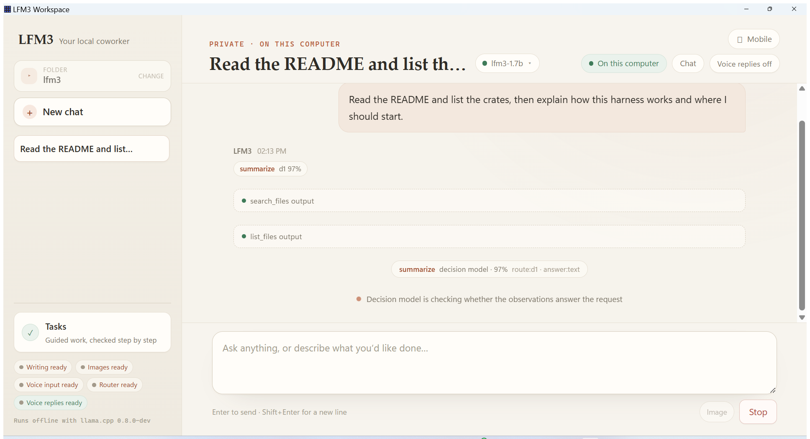

# LFM3 Workspace v0.1.1

**A fully local, chat-first cowork harness for Liquid AI's LFM3 family — Rust, React, Tauri 2, and pinned llama.cpp. Now with a native Linux desktop build.**

Everything runs on your own machine: no account, no cloud calls, no telemetry. Four local models cover the work — LFM3-1.7B acts and writes, LFM3-VL-2B looks at images, LFM3-Audio-2B hears and speaks, and d1-2B routes each turn and checks evidence. The harness shows every tool call, keeps writes behind an exact-diff approval, and never reports unverified work as finished.

## What changed since v0.1.0

- **Native Linux desktop.** The same Tauri interface now builds and runs on Linux x86_64 as a `.deb` and an `.AppImage`, alongside the Windows NSIS installer. Both are produced from the same tag by the release workflow.
- **Linux process containment.** Owned model servers, command tools, and lifecycle probes are spawned into their own process group on Unix and terminated together when the app exits, replacing the Windows-only Job Object path. The supervisor reports which containment mechanism a platform provides, and unsupported platforms refuse to start children instead of leaking them.
- **Resources are found where packages put them.** The desktop shell now seeds `LFM3_LLAMA_SERVER` and `LFM3_LLAMA_TTS` from the Tauri resource directory before the engine reads its configuration, so a `.deb` install (`/usr/lib/LFM3 Workspace/tools/llama`) and an AppImage mount point resolve the bundled runtime exactly like the Windows installer does. A path the person already set is never replaced.
- **Bundled shared libraries resolve first.** Every harness-owned llama.cpp process gets its own directory at the front of `LD_LIBRARY_PATH` on Linux, so the packaged `libggml*`, `libllama*`, and `libmtmd*` are used even when a system copy exists. Windows behavior is unchanged.
- **Deterministic shutdown on both platforms.** The application job now shuts down owned children when it is dropped, not only on the explicit shutdown path, so a normal Windows exit and a Linux exit both reap model servers.
- **Linux data directory.** Application state, SQLite journals, chat transcripts, attachments, and downloaded weights live under `$XDG_DATA_HOME/LFM3Harness`, or `~/.local/share/LFM3Harness` when that variable is unset. Windows keeps `%LOCALAPPDATA%\LFM3Harness` and now falls back to `%USERPROFILE%\AppData\Local` when `LOCALAPPDATA` is missing instead of writing into the working directory.
- **One release workflow for all assets.** A single GitHub Actions workflow builds the Windows installer, the Linux `.deb`/`.AppImage`, and the Linux CLI archive from the tag, publishes them together, and writes a generated checksum table into the release body.
- **Linux icon set and platform config.** `tauri.linux.conf.json` selects the `.deb` and AppImage targets and the PNG icon set, while the Windows bundle keeps its `.ico` plus PNGs.
- **Packaging fixes.** The release staging script is now the single place that assembles the llama.cpp allowlist on both hosts, the Unix lifecycle test ships in the tree, and cross-platform unit tests no longer assume Windows path semantics.

Nothing in v0.1.0 was removed. The 32,000-token context, the model downloader, routing, evidence gate, and verified tasks behave as before.

## What the application does

- **Two surfaces, one engine.** Chat for open-ended work, and **Verified tasks** for anything that must be machine-certified. A chat message can never satisfy a mission check.
- **Four local roles.** LFM3-1.7B writes and acts, VL-2B reads images, Audio-2B transcribes speech and speaks answers, d1-2B routes each turn and checks evidence. The sidebar shows every role's state: Loaded, Installed, or Missing.
- **Guided model download.** The **Models** menu lists all four pinned roles with sizes and SHA-256 digests. A download starts only on an explicit click, streams to a `.part` file with visible progress, verifies length and digest, then moves it into the models folder. Nothing is fetched in the background.
- **Manual weights are detected.** GGUF files you copy into the models folder are found on the next launch or with **Reload installed models**; the folder path is shown at the top of the menu.
- **Routing and decision gates.** d1 classifies messages of 24 characters or more into a task shape before the acting model runs, and is asked twice more inside a turn: a **write gate** can withhold a change that contradicts your last request, and an **evidence gate** can tell the model to state what evidence is missing. Neither gate can approve, deny, or execute anything; you still decide every write.
- **Workspace-confined tools.** `list_files`, `read_file`, `search_files`, `related_files`, `write_file`, and `edit_file`, all bounded by the folder chip. `look` appears only when the vision model is installed, `transcribe` only when the audio model is. Paths outside the workspace are rejected.
- **Exact-diff approval.** Every write or edit appears inline with its path and full content or diff. **Allow once** executes it, **Deny** leaves the file untouched. Pending actions expire after ten minutes and survive a restart.
- **Image attachments.** PNG, JPEG, WebP, or GIF up to 20 MB, stored under `.attachments/` inside the workspace and inspected through the local vision model.
- **Voice in and out.** Record a message and Audio-2B transcribes it locally; **Speak** reads any answer aloud through the bundled `llama-tts`, entirely offline. A voice-replies toggle keeps answers spoken.
- **Conversations persist.** Chat transcripts live in `chat.db` in the trusted data directory, with rename, delete, and new-chat controls in the sidebar.
- **Stop means stop.** Stop cancels the stream and any pending approval; a turn is capped at twelve tool rounds and one bounded turn runs at a time.
- **Missions stay separate.** Frozen acceptance contracts, provenance-bound deterministic checks, recovery budgets, and a SQLite journal decide whether a verified run passes. Three semantic missions remain `human_review_only`; only `desk_task` has an end-to-end real-model acceptance.
- **Offline after setup.** No account, no telemetry, no network calls at runtime. The only network activity is the models you choose to download and, separately, the Tauri CLI fetching packaging tools at build time.

## Downloads

All assets are attached to this release and built from the same tag by the release workflow. The **Checksums** section at the end of this page is generated from the uploaded files.

| Platform | Asset | What it contains |
| --- | --- | --- |
| Windows x64 · Desktop | `LFM3.Workspace_0.1.1_x64-setup.exe` (NSIS, unsigned) | Desktop app, React UI, missions, pinned CPU llama.cpp runtime |
| Linux x64 · Desktop | `LFM3.Workspace_0.1.1_amd64.deb` | Same app as a Debian/Ubuntu package with declared WebKitGTK and GTK dependencies |
| Linux x64 · Desktop | `LFM3.Workspace_0.1.1_amd64.AppImage` | Same app as a portable executable |
| Linux x64 · CLI | `LFM3-Workspace_0.1.1_linux-x64_cli.tar.gz` | Headless `lfm3` CLI, missions, `run.sh`, and the Linux llama.cpp runtime |

No GGUF weights are inside any asset; each package is roughly 15–60 MB. The CUDA backend, development tools, and all weights are excluded, which is what keeps the Windows installer near 15 MB.

## Install on Windows

1. Download `LFM3.Workspace_0.1.1_x64-setup.exe` and run it. The installer is unsigned, so SmartScreen may ask you to choose **More info → Run anyway**.
2. Launch **LFM3 Workspace**. The app opens on chat and looks for the bundled runtime and any installed weights.
3. Open the **Models** menu in the chat header and click **Download** for the roles you want:
   - **Text and agent** — `LFM3-1.7B-Q4_K_M.gguf`, 1.10 GB
   - **Vision** — `LFM3-VL-2B-QAD-Q4_0.gguf` + `mmproj-LFM3-VL-2B-Q8_0.gguf`, 1.25 GB
   - **Voice in and out** — `LFM3-Audio-2B-Q4_K_M.gguf` + `mmproj-LFM3-Audio-2B-Q8_0.gguf`, 1.40 GB
   - **Decision** — `d1-2B-Q4_K_M.gguf`, 1.10 GB
4. Choose a folder with the folder chip, then ask a question, attach an image, or record a voice message.

Default folders on Windows: models in `%LOCALAPPDATA%\LFM3Harness\models` (one subfolder per upstream repository), state and transcripts in `%LOCALAPPDATA%\LFM3Harness`. Set `LFM3_MODELS_DIR` to point at an existing weights folder instead.

## Install the Linux desktop

Debian or Ubuntu:

```bash
sudo apt install ./LFM3.Workspace_0.1.1_amd64.deb
lfm3-desktop
```

The package declares its WebKitGTK 4.1 and GTK 3 dependencies, installs the desktop entry, and places the bundled llama.cpp runtime under the app's resource directory.

AppImage:

```bash
chmod +x LFM3.Workspace_0.1.1_amd64.AppImage
./LFM3.Workspace_0.1.1_amd64.AppImage
```

The host needs `libwebkit2gtk-4.1-0` and `libgtk-3-0`. State, chat transcripts, and downloaded models live in `$XDG_DATA_HOME/LFM3Harness` or `~/.local/share/LFM3Harness`. Linux has the same in-app **Models** downloader as Windows.

If you would rather build it yourself:

```bash
./run.sh deps      # Rust, Node.js, UI modules, WebKit check
./run.sh desktop   # development mode
./run.sh bundle    # .deb and .AppImage in target/release/bundle/
```

## Install the Linux CLI

```bash
tar -xzf LFM3-Workspace_0.1.1_linux-x64_cli.tar.gz
cd LFM3-Workspace-linux-x64
mkdir -p models && cp /path/to/*.gguf models/
./run.sh doctor
./run.sh models --probe
./run.sh run --mission desk_task \
  --input ../tests/fixtures/desk_task/basic.json \
  --workspace ./workspace
```

`run.sh` points `LFM3_LLAMA_SERVER` at the bundled `tools/llama/llama-server` and `LFM3_MODELS_DIR` at `models/` when those exist. The CLI archive has no downloader; supply the same pinned GGUF files. It was built on Ubuntu 22.04 x64.

## Screenshots



*The chat surface with the bundled llama.cpp runtime detected and all four local roles ready. The folder chip is the only workspace boundary the tools can reach.*



*A real turn in progress: `search_files` and `list_files` output, the d1 route, the evidence gate, and the Stop control while the harness keeps working.*

## Requirements

- Windows 10 or 11 x64, or Linux x86_64 with a recent glibc. The Linux desktop also needs WebKitGTK 4.1 and GTK 3; the `.deb` installs them, while an AppImage host must provide them.
- CPU inference; no GPU is required or configured (`-ngl 0`).
- 8 GB of RAM for chat with the text role, more when vision, voice, and routing run alongside it.
- About 4.9 GB of disk for all four roles, plus the workspace you work in.

## Upgrading from v0.1.0

Install over the previous build; your models, conversations, and settings stay where they are. Windows keeps `%LOCALAPPDATA%\LFM3Harness`. There are no migrations, no model re-downloads, and no protocol changes between the app and its models.

## Verification

- `cargo test -p lfm3-harness --lib` passes on Windows, along with the Unix process-supervisor tests on Linux.
- The packaged Windows lifecycle test exercises abrupt application termination and confirms owned children do not survive it; the Unix lifecycle test covers the process-group equivalent.
- `cargo check -p lfm3-desktop -p lfm3-cli` passes for both platforms.
- The release workflow builds the Windows installer with NSIS, the Linux `.deb`/`.AppImage` with the Tauri bundler, and the Linux CLI archive, then attaches all of them to this release with generated SHA-256 digests.
- The Windows installer in the v0.1.0 line was launched against real local weights for all four roles and produced the turn shown in the second screenshot. This v0.1.1 build is produced by the workflow; it was not re-launched on a Linux desktop host in this session.

## Known limitations

- Both the Windows installer and the Linux packages are unsigned, so SmartScreen warns on first run.
- The runtime is CPU-only; expect slower turns than a GPU build.
- Three semantic missions remain `human_review_only`; only `desk_task` has an end-to-end real-model acceptance.
- Linux has no system-voice fallback: without the LFM3 audio pair, speech output reports that the local voice is unavailable rather than borrowing a system voice.
- The Linux desktop packages are built and attached by the workflow; they were not interactively launched on a Linux host in this session.

## Checksums

The table below is appended by the release workflow from the uploaded assets, so it always matches the files on this page. The same values are attached as `SHA256SUMS.txt`.
